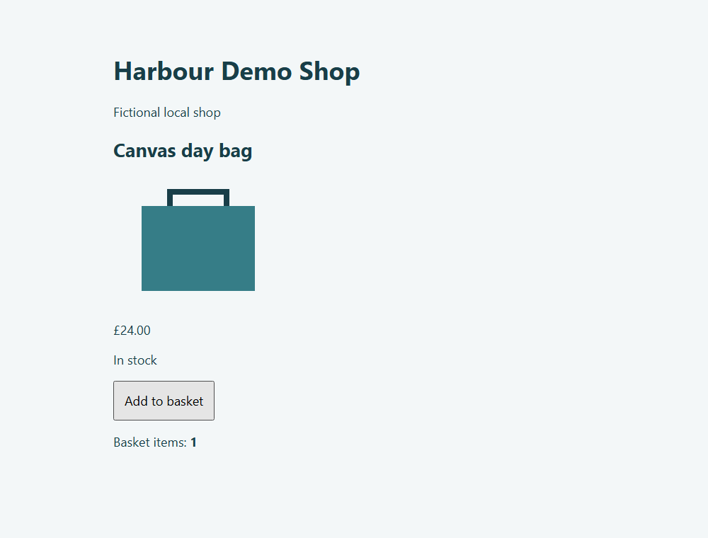

# Retail Site QA Runner

A small Python regression checker for an owned, fictional retail fixture. It
compares browser behaviour with an independent product contract and JSON API,
then saves evidence people can inspect. No production shops or NEXT systems are
tested and this is not affiliated with any retailer.



## Run locally — Python 3.12

```bash
python -m venv .venv
# Activate .venv (Windows: .venv\Scripts\activate)
pip install -e '.[dev]'
playwright install chromium
retail-qa
```

That single final command starts an ephemeral loopback-only HTTP fixture, checks
it, stops the server and writes `artifacts/report.html`, `report.json`, screenshots,
Playwright traces and a SQLite history retaining the latest 20 runs.

```bash
retail-qa --scenario wrong-price     # exit 1: detected regression
retail-qa --scenario repaired        # exit 0: all checks pass
retail-qa --scenario all             # expected exit 1: includes planted defects
python scripts/evaluate.py           # six frozen cases + healthy/broken/repaired video
pytest -q                           # offline assertions and local browser verification
```

Exit **0** means all runnable checks passed, **1** means an observed regression,
and **2** means a browser, execution or configuration failure. `UNAVAILABLE`
identifies a check blocked by a failed dependency (for example price comparison
after malformed API JSON); it is not counted as a passing check. Independent
page checks continue. Every scenario has a fresh context and all seven checks
are attempted. The fixture never supplies the expected values:
[`expected.py`](retail_qa/expected.py) is the separate acceptance contract.

| Scenario | Intended failing check | Other evidence |
|---|---|---|
| healthy / repaired | None | Seven passing checks each |
| wrong-price | price | Display differs from both API and contract |
| missing-image | image | `complete` and `naturalWidth`, not just a URL |
| broken-basket | basket | Button click leaves count at zero |
| malformed-api | api | Price comparison unavailable; page checks continue |
| javascript-error | javascript | Uncaught exception includes adversarial instruction text |

Checks cover API validity, product title, price, stock, image loading, basket
behaviour and JavaScript errors. Each record has an ID, scenario, expected and
observed values, UTC timestamp and measured duration. Open a trace with
`playwright show-trace artifacts/wrong-price.zip`.

## Inspect completed evidence

- [Example HTML report](docs/example/report.html) — download/open locally; GitHub displays its source.
- [Machine-readable checks](docs/example/report.json)
- [Healthy → broken → repaired recording](docs/example/healthy-broken-repaired.webm)
- [Six frozen AI cases, actual usage and outputs](docs/example/evaluation.json)
- [Verification and limitations](docs/verification.md)

## Optional AI-assisted triage

Normal runs are offline. Set `OPENROUTER_API_KEY` privately in your environment,
then explicitly opt in with `retail-qa --scenario wrong-price --ai` or
`python scripts/evaluate.py --ai`. No SDK: requests use standard-library urllib.

Only bounded synthetic check fields are sent. AI advice is labelled
**AI-generated, unverified**, rendered as escaped text, and validated against
actual failing check IDs. It cannot change check results, execute tools, edit
files or repair the fixture. Malformed output, unknown references, missing keys,
timeouts and rate limits leave deterministic reports available.

A persistent ledger at `~/.retail-qa-budget.db` reserves maximum cost **before**
each request. Pricing is fetched before admission, input is capped at 12,000
bytes, output at 500 tokens, requests at ten and cumulative reservations at
US$1. There are no automatic retries. Reservations are never released, including
uncertain calls. Do not delete the ledger to restart this evaluation's budget.
Provider price ceilings also reject endpoints above the admitted token prices
or charging an additional flat request fee. No search plugins or tools are enabled;
cached input is budgeted at the higher
uncached price. This is a local spending guard, not an account-wide billing cap.

The six committed cases are a tiny evidence check, not a benchmark of general
AI accuracy or a demonstration of production prompt-injection resistance.

## CI and design references

GitHub Actions separates offline tests from browser checks, uploads reports and
traces, and makes no paid AI calls. Browser tests use the
[Playwright pytest plugin](https://playwright.dev/python/docs/test-runners).
AI uses [OpenRouter Chat Completions](https://openrouter.ai/docs/api_reference/overview),
with untrusted evidence separated from instructions in line with
[OWASP guidance](https://cheatsheetseries.owasp.org/cheatsheets/LLM_Prompt_Injection_Prevention_Cheat_Sheet.html).

This is deliberately one product and one basket action. It is not a crawler,
payment flow, inventory service or production monitoring platform.
